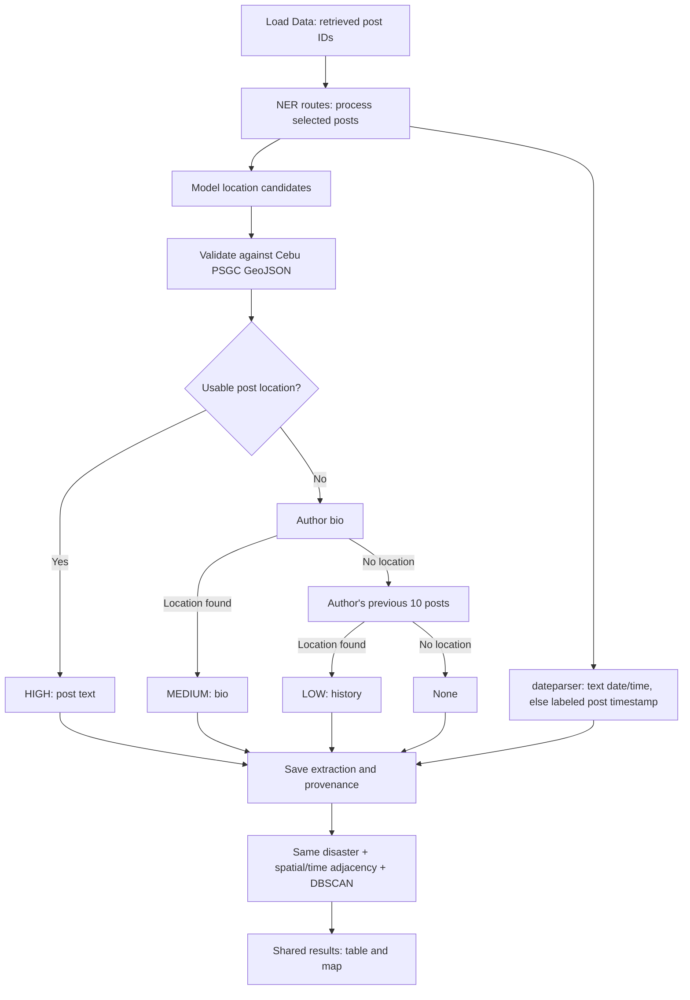

# Spatiotemporal pipeline: defense code guide

Start with `agapai_api/ner_routes.py`, then follow the four numbered sections in
`agapai_api/ner_algorithm.py`. Location extraction and time extraction share that
existing module; the temporary `ner_location_matching.py` and `ner_temporal.py`
modules were removed.

| File | Responsibility | Main entry points |
| --- | --- | --- |
| [ner_routes.py](agapai_api/ner_routes.py) | Loaded-post selection, author context, batching, persistence, shared table/map results | `process_all_posts`, `_resolve_with_author_context`, `_fetch_previous_post_texts`, `_build_event_lookup`, `get_selected_results` |
| [ner_algorithm.py](agapai_api/ner_algorithm.py) | Model candidates, hierarchy/disambiguation, source confidence, date/time parsing | `extract_location_entities`, `resolve_post_location`, `extract_explicit_datetime` |
| [ner_gazetteer_loader.py](agapai_api/ner_gazetteer_loader.py) | Validate names and obtain canonical PSGC IDs, parents and coordinates | `find_exact`, `names_in_entity`, `find_by_parent` |
| [ner_event_clustering.py](agapai_api/ner_event_clustering.py) | Haversine distance, DBSCAN grouping, event representative and date | `is_same_event`, `cluster_posts_into_events`, `build_event_summary` |
| [Cebu_Province_PSGC_Gazetteer.geojson](agapai_api/Cebu_Province_PSGC_Gazetteer.geojson) | Sole permitted spatial dataset | `features[].properties` and `features[].geometry` |
| [spatiotemporal.js](../dashboard/src/spatiotemporal.js) | Submit loaded IDs, finish all batches, fetch shared results | `loadSpatiotemporalData`, `locationDisplayItems` |
| [NERTableView.jsx](../dashboard/src/NERTableView.jsx), [NERMapView.jsx](../dashboard/src/NERMapView.jsx) | Render the same selected rows and event clusters | Table, event list, markers, legend |



## Location decisions and confidence

- calamanCy supplies LOC/ORG entities, part-of-speech tags and dependency labels.
  Proper nouns and capitalized nominal modifiers provide additional candidates
  when the entity recognizer misses a name. Only those candidate spans are checked
  against the GeoJSON; the whole post is not scanned for gazetteer keywords.
- Matching uses complete words and the longest valid name. Repeated mentions are
  deduplicated by PSGC ID, so different places with the same name remain distinct.
- An exact province name takes precedence over a city alias. `Cebu` identifies
  the file's province entry; `Cebu City` identifies its city entry.
- Scope means **membership in this specific GeoJSON**, including the independent
  cities and their barangays already present in it. No external geocoder supplies
  coordinates. Coordinates are gazetteer representative points, not incident GPS.
- Confidence identifies the source: post HIGH, bio MEDIUM, previous posts LOW.
  `confidence_source` stores that source; `resolution_method` separately records
  direct gazetteer resolution, author-context disambiguation, or the centroid rule.
- A recognized but ambiguous post location remains under review if context cannot
  identify its parent. An unrelated bio location does not replace it. Only actual
  gazetteer candidates appear as ambiguities; zero-match strings are discarded.
- Bio and history are fetched only when needed. History is paginated, limited to
  ten authored posts before the current post, and excludes the current post,
  later posts, duplicates and other authors' reposts. It is not restricted to the
  disaster posts in the loaded dashboard selection. Profile lookup reads the
  author's current bio; historical bios are not available through this lookup.

## Time and clustering

Temporal extraction uses the date libraries' language detection, then retries
unresolved text through the local translation model and the same parsers.
Relative expressions use the post timestamp in Asia/Manila. Date and time are
resolved independently: an unrecognized or absent date/time component falls
back to the corresponding part of the post timestamp. If neither component is
recognized, both come from `created_at`. Missing components are stored as null,
not the truthy string `"None"`.

Parser and translation coverage still determines which expressions can be
recognized. Unrecognized colloquial forms use the timestamp fallback rather
than being converted by a hand-maintained phrase list.

Event links use the existing parameters: same disaster class, at most 2 km apart,
and at most 6 hours between posting timestamps. DBSCAN groups connected reports
with `min_samples=1`, retaining isolated reports as one-post events. Connected
chains can span more than the pairwise thresholds. The separate 5 km centroid
rule disambiguates names using directly resolved HIGH locations in the selected
posts; inferred locations do not become new anchors.

Table and map receive the same event IDs. The map fits the available event
coordinates and has five disaster classes in the legend, without Unknown.
For equally confident locations in one post, its most specific gazetteer entry
supplies the map/clustering point. A province mention does not displace a barangay
or add a second coarse point to that post's centroid anchors.

## Keyword / hardcoding audit

NER contains no manually maintained place lists, disaster-word lists, language
prefix lists, day-part dictionaries, or example-specific location/time answers.
Gazetteer names/parents/coordinates are read from the GeoJSON. Settlement aliases
are derived from its administrative types and spaCy's supplied function words.
Temporal language rules belong to the dateparser library; this is library-based
parsing, not a claim that the library itself has no rules or vocabulary.

Model IDs/version, locale codes, confidence/schema labels, the ten-post limit,
batch size and distance/time thresholds are explicit configuration/algorithm
parameters. Marker styling and the initial map viewport are display settings.
They do not identify locations by words in a post.

The broader collection/classification code (`geography.py`, `retrieval.py`,
`pipeline.py`) still contains existing keyword/heuristic logic. That is outside
the NER extraction implementation and has not been declared keyword-free. NER
does not trust its `location_name` field as ground truth.

## Verification and running

From `agapai/api`:

```powershell
..\.venv\Scripts\python.exe -m unittest discover -s tests -v
..\.venv\Scripts\python.exe -m uvicorn agapai_api.app:app --reload --host 127.0.0.1 --port 8000
```

Backend tests use an isolated temporary MongoDB database and mock model
predictions/Bluesky responses. They exercise the real gazetteer, date library,
clustering and route/database logic. They do not replace live model evaluation.

From `agapai/dashboard`:

```powershell
node --test src/spatiotemporal.test.js
npm run lint
npm run build
npm run dev -- --host 127.0.0.1 --port 5173 --strictPort
```

MongoDB must be running; use your existing Bluesky credentials for author lookups.
Restart the API after code changes, then reload the dashboard and load data (or
refresh spatiotemporal info). The extraction version invalidates old NER results.
